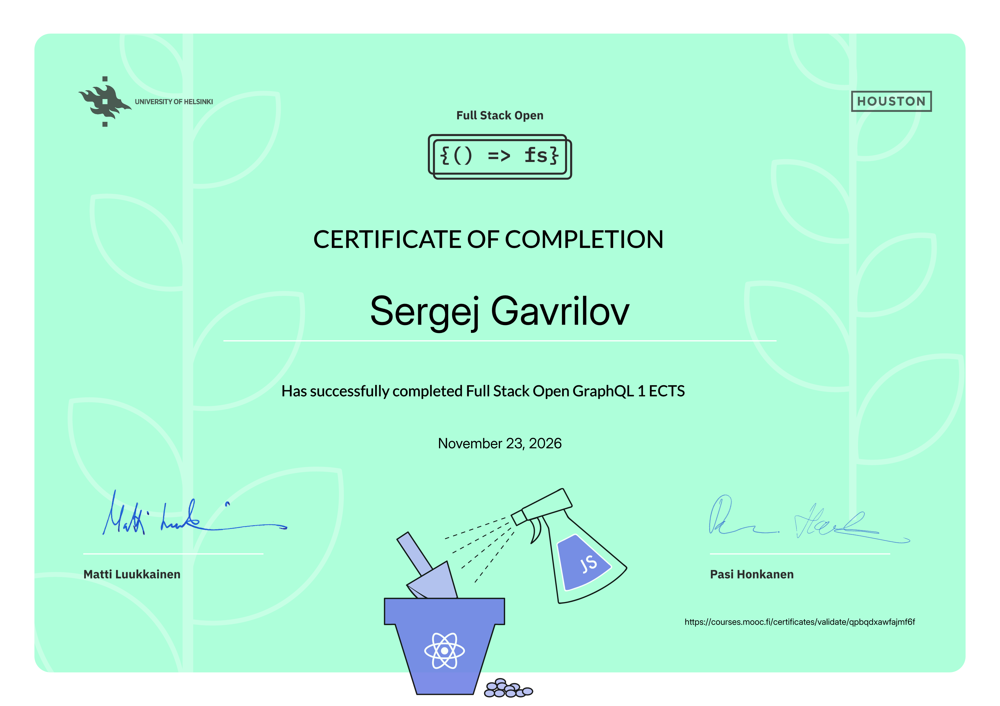

# Full Stack Open — Part 8

Solutions for [Full Stack Open, part 8: GraphQL](https://fullstackopen.com/en/part8).

Parts 0–5: [fullstack-open-part00-05](https://github.com/Kopfdreher/fullstack-open-part00-05). Part 6: [fullstack-open-part06](https://github.com/Kopfdreher/fullstack-open-part06). Part 7: [fullstack-open-part07](https://github.com/Kopfdreher/fullstack-open-part07).

A library API with [Apollo Server](https://www.apollographql.com/docs/apollo-server) and a React client. Queries and mutations are tested with Node; the UI with Playwright.

| Directory | What it covers |
| --- | --- |
| `library-backend` | Apollo Server library API |
| `library-frontend` | React client |
| `tests-chapter4` | Node tests for queries and mutations |
| `tests-chapter5` | Playwright tests for the UI |

- Backend: `cd library-backend && npm install && npm run dev` (port 4000)
- Frontend: `cd library-frontend && npm install && npm run dev`
- API tests: `cd tests-chapter4 && npm install && npm test` (in-memory MongoDB)
- UI tests: `cd tests-chapter5 && npm install && npx playwright install chromium && npm test` (Playwright starts both apps)

## Certificate

